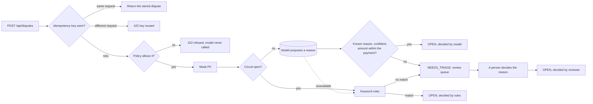

# Payment disputes service

[](https://github.com/alejandrolunatech/payment-disputes-spring-boot/actions/workflows/ci.yml)


A card payment dispute service in Spring Boot 4 and Java 21. A customer says what went wrong with a payment; a language model reads the complaint and proposes a reason; plain, tested code decides whether to accept it, ask a person, or fall back to rules.

## Why now

Most backend teams are being asked to "add AI" to a workflow that moves money. The hard part is not calling the model. It is everything around it: personal data must not leak to a vendor, a retried request must not create a second case, a confident wrong answer must not skip a human, and the service must keep working when the model is down. This repo is a small, complete example of that, built on the current Spring stack (Boot 4.1, Spring Framework 7, Spring AI 2, Jakarta EE 11).

The rule throughout is **deterministic core, probabilistic edge**: the model proposes, and code decides.

## What this shows

| Skill | Where to look |
| --- | --- |
| Hexagonal architecture, enforced by tests | [`ArchitectureTest`](src/test/java/com/alejandrolunatech/disputes/ArchitectureTest.java), [ADR 0001](docs/adr/0001-hexagonal-layout.md) |
| A domain model with no framework in it | [`Dispute`](src/main/java/com/alejandrolunatech/disputes/domain/Dispute.java), [`DisputeStatus`](src/main/java/com/alejandrolunatech/disputes/domain/DisputeStatus.java), [`DisputePolicy`](src/main/java/com/alejandrolunatech/disputes/domain/DisputePolicy.java) |
| Sealed types and exhaustive `switch` for outcomes | [`Triage`](src/main/java/com/alejandrolunatech/disputes/domain/Triage.java), [`DisputeApi.TriageView`](src/main/java/com/alejandrolunatech/disputes/adapter/in/web/DisputeApi.java) |
| Checking model output with plain code | [`TriageService.check`](src/main/java/com/alejandrolunatech/disputes/application/TriageService.java), [ADR 0002](docs/adr/0002-model-proposes-code-decides.md) |
| Idempotency keys with a request fingerprint | [`DisputeService.open`](src/main/java/com/alejandrolunatech/disputes/application/DisputeService.java), [ADR 0003](docs/adr/0003-idempotency-and-short-transactions.md) |
| Optimistic locking, and no transaction held across a model call | [`JpaDisputeRepository`](src/main/java/com/alejandrolunatech/disputes/adapter/out/persistence/JpaDisputeRepository.java) |
| RFC 9457 problem responses with stable types | [`ProblemResponses`](src/main/java/com/alejandrolunatech/disputes/adapter/in/web/ProblemResponses.java), [docs/problems.md](docs/problems.md) |
| Spring AI 2 structured output, behind a port | [`SpringAiTriageModel`](src/main/java/com/alejandrolunatech/disputes/adapter/out/llm/SpringAiTriageModel.java) |
| Circuit breaker with a rules fallback (Resilience4j) | [`TriageService`](src/main/java/com/alejandrolunatech/disputes/application/TriageService.java), [`KeywordRules`](src/main/java/com/alejandrolunatech/disputes/application/KeywordRules.java) |
| PII masking before anything is stored or sent | [`PiiMasker`](src/main/java/com/alejandrolunatech/disputes/application/PiiMasker.java) |
| An eval harness on labelled cases | [`TriageEval`](src/test/java/com/alejandrolunatech/disputes/eval/TriageEval.java), [docs/evals](docs/evals/README.md) |
| Integration tests on a real PostgreSQL (Testcontainers 2) | [`DisputesApiIntegrationTest`](src/test/java/com/alejandrolunatech/disputes/DisputesApiIntegrationTest.java) |

## How a dispute is triaged



After triage, a dispute moves through `OPEN → EVIDENCE_SUBMITTED → WON | LOST`, and can be `WITHDRAWN` before evidence is sent. Every allowed move is in one `switch` in [`DisputeStatus`](src/main/java/com/alejandrolunatech/disputes/domain/DisputeStatus.java), and every response lists the moves allowed next.

## What happens when something goes wrong

| Failure | What the code does |
| --- | --- |
| The client retries a request after a timeout | The same `Idempotency-Key` and body return the dispute created the first time; the model is not called again |
| The same key arrives with a different body | `422`, with problem type `idempotency-key-reused` |
| Two requests with the same key race each other | The database's unique key lets one win; the other returns the winner's dispute |
| Two people change the same dispute at once | Optimistic locking: the second gets `409 concurrent-update` |
| The model times out, is rate limited or returns something unreadable | Keyword rules answer; if none match, a person decides |
| The model keeps failing | The circuit opens and the rules answer at once, without waiting for timeouts |
| The model invents a reason, or gives a confidence outside 0 to 1 | A person decides |
| The model is unsure (confidence below 0.75) | A person decides |
| The statement claims more money than the payment | A person decides, whatever the model says |
| The statement contains an email, IBAN, card or phone number | Masked before it is stored, logged or sent |
| A request breaks the policy (too old, too much, other currency) | `422 dispute-refused`, before any model cost |

Every model call is recorded in `model_calls`: model, tokens, latency and outcome. The statement itself is never logged.

## The API

| Method and path | What it does |
| --- | --- |
| `POST /api/disputes` (header `Idempotency-Key`) | Opens a dispute and triages it |
| `GET /api/disputes/{id}` | Reads one dispute |
| `GET /api/disputes/review-queue?limit=20` | Disputes waiting for a person, oldest first |
| `POST /api/disputes/{id}/reason` | A person decides the reason: `{"reasonCode":"FRAUD"}` |
| `POST /api/disputes/{id}/evidence` | Evidence was submitted |
| `POST /api/disputes/{id}/resolution` | `{"won":true}` or `{"won":false}` |
| `POST /api/disputes/{id}/withdrawal` | The customer withdraws |

Errors are `application/problem+json` with a stable `type`; the list is in [docs/problems.md](docs/problems.md).

## Quickstart

You need Java 21 or newer and Docker. The Maven wrapper downloads Maven itself.

```bash
git clone https://github.com/alejandrolunatech/payment-disputes-spring-boot.git
cd payment-disputes-spring-boot
./mvnw verify
```

To run the service on a throwaway PostgreSQL container:

```bash
./mvnw spring-boot:test-run
```

Then open a dispute against one of the demo transactions (`TX-1001` to `TX-1006`):

```bash
curl -s localhost:8080/api/disputes \
  -H 'Content-Type: application/json' -H 'Idempotency-Key: demo-key-0001' \
  -d '{"transactionReference":"TX-1001","amount":89.95,"currency":"EUR","statement":"I did not make this payment, my card was stolen. Mail me at ana@example.com"}'
```

By default the service runs **offline**: a scripted stand-in replaces the model, so no key and no cost. It is [clearly not a model](src/main/java/com/alejandrolunatech/disputes/adapter/out/llm/ScriptedTriageModel.java); add `#outage` to a statement to watch the fallback and the circuit breaker work.

To use a real model through OpenRouter, put the key in the environment and turn on the `openrouter` profile. With 1Password:

```bash
op run --env-file=op.env -- ./mvnw spring-boot:test-run -Dspring-boot.run.profiles=openrouter
```

The model is set by `TRIAGE_MODEL` and defaults to the one in [`application-openrouter.yml`](src/main/resources/application-openrouter.yml).

## Evals

[`TriageEval`](src/test/java/com/alejandrolunatech/disputes/eval/TriageEval.java) runs 40 labelled, synthetic statements (English, Dutch and Spanish; 34 with a clear reason, 6 that a person should decide, including a prompt-injection attempt) through the real `TriageService`. It measures the whole decision: model, checks and fallback together.

The number that matters most is **decided without a person, and wrong**: that is the error that costs money. The automation rate comes second.

| Run | Decided without a person | Decided without a person, and wrong | Unclear cases sent to a person |
| --- | --- | --- | --- |
| Scripted stand-in (not a model; English keywords only) | 13 / 40 | 0 | 6 / 6 |
| Real model | PENDING: first run planned in November 2026 | PENDING | PENDING |

CI runs the harness on the scripted stand-in on every build, to keep the harness and the safety checks working. Real-model results will be committed to [docs/evals](docs/evals/README.md) with the date, model and settings; none are invented here.

## Tests and quality

- **Domain and use-case tests** in plain JUnit 6, with hand-written fakes for the ports.
- **API tests** with `@WebMvcTest` and `MockMvcTester`, for status codes, validation and problem types.
- **Integration tests** against PostgreSQL 17 in Testcontainers, through HTTP, Flyway and JPA.
- **Architecture rules** with ArchUnit: the domain is plain Java, the use cases know no adapter, and only the LLM adapter touches Spring AI.
- **CI** on every pull request: build and tests on Java 21 and 25, and a gitleaks secret scan over the full history.
- The build compiles with warnings as errors.

## Decisions

- [ADR 0001: Hexagonal layout with a plain-Java core](docs/adr/0001-hexagonal-layout.md)
- [ADR 0002: The model proposes, code decides](docs/adr/0002-model-proposes-code-decides.md)
- [ADR 0003: Idempotency keys, and no transaction across the model call](docs/adr/0003-idempotency-and-short-transactions.md)
- [ADR 0004: Spring Boot 4 and Spring AI 2 on Java 21](docs/adr/0004-spring-boot-4.md)
- [ADR 0005: Offline by default](docs/adr/0005-offline-by-default.md)

## Trade-offs, and what I'd change for production

- **The dispute rules are made up** (a 120-day window, 10 or 20 days to respond). Real card scheme rules are longer and differ per scheme.
- **There is no authentication yet.** Version 1.1 adds JWT resource-server security with a reviewer role.
- **PII masking is regex-based.** It catches the common formats. Production needs a dedicated detector and an audit of what was masked.
- **The model's confidence is its own estimate**, so it is a weak signal. It only chooses between "accept" and "ask a person", and the evals are what tell you where to set the threshold.
- **The checks cannot stop every prompt injection.** A statement can still talk a model into a wrong reason. The checks bound the damage (amounts, known reasons, a confidence floor), and the eval set includes an injection case so a model that obeys it shows up as a wrong decision.
- **Events are not published yet.** Version 1.1 adds a transactional outbox so other services hear about status changes exactly once.

## Roadmap

Version 1.1 (planned for 18 November 2026): transactional outbox, JWT security with a reviewer role, OpenTelemetry traces and metrics, a small Thymeleaf and htmx review page, and migration notes from Spring Boot 3 to 4.

## How this was built

Designed and reviewed by Alejandro Aguirre Luna. Implemented with AI coding agents (Claude Code) under my direction; I reviewed and merged every pull request and can walk through every decision. A self-directed portfolio project, not client or production work. All transactions, merchants and statements are made up.

My own notes are in [docs/LEARNING-NOTES.md](docs/LEARNING-NOTES.md).

## License

Code: [MIT](LICENSE). Documentation (`*.md`): [CC BY 4.0](LICENSE-docs).
